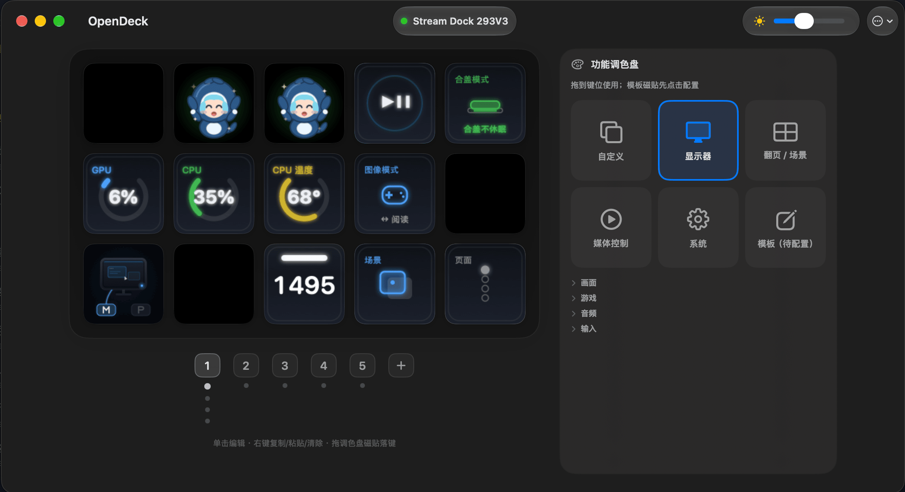

# OpenDeck for macOS

macOS 平台、针对 MiraBox Stream Dock 的 Swift 实现。目标设备 **293V3**，替代 1GB+ 的原厂 app，构建产物 **5.6 MB**。



## 为什么做这个

原厂 StreamDock.app 体积 1GB+，只为改 15 个键位的图标和动作。这个项目做了同一件事，体积是它的 1/180。

## 能力
应用本身为空壳，下面的功能是透过agent自定义的，仅供参考。
| 能力 | 说明 |
|---|---|
| 键位编辑 | 15 键（5×3），键面 112×112 JPEG，设备以 180° 旋转显示 |
| 插件宿主 | 兼容 Elgato Stream Deck SDK v2 的插件协议（WebSocket + Property Inspector） |
| 显示器控制 | 通过 DDC/CI 切换输入源、亮度，键面显示当前状态动效 |
| 键盘热力图 | 从 KeyAnalyze 读键位热度，实时渲染到键面 |
| 场景路由 | 按前台应用自动切换场景，支持多页 |
| 亮度跟随 | 内屏亮度变化时同步调整设备背光 |

**168 个单元测试**，覆盖协议编解码、配置迁移、状态机、WebSocket 服务端。

## 构建

```bash
git clone https://github.com/OmgYork/opendeck.git
cd opendeck

swift build          # 增量构建
swift test           # 168 个测试
./make-app.sh        # 组装 dist/OpenDeck.app 并 ad-hoc 签名

open dist/OpenDeck.app
```

要求：macOS 26+，Xcode 26+（Swift 6.2）。

## 文档

| 你想做的事 | 读 |
|---|---|
| 了解开发史、协议实测、设计决策 | [`HANDOFF.md`](HANDOFF.md) |
| 接入状态灯 / 开发插件 | [`AGENT-GUIDE.md`](AGENT-GUIDE.md) |
| 看变更记录 | [`CHANGELOG.md`](CHANGELOG.md) |
| 给 agent 用的入口 | [`AGENTS.md`](AGENTS.md) |

## 许可证

Apache License 2.0，见 [LICENSE](LICENSE)。


## 转发给其他 agent 的模板

```text
请在 ~/Projects/mirabox 下工作。
先读 AGENT-GUIDE.md，并遵守 §2 的硬规矩（不要运行时改配置、不要动保留槽、不要提交）。
只做状态灯：读 Scripts/状态灯接入指南.md。
改完跑 swift build && swift test，并把新事实追加到 HANDOFF.md §6.x。
```

## 多 agent 文档改动检测

多个 agent 共用这套文档时，用基线快照判断「哪些内容不是我写的」：

```bash
python3 Scripts/docs_baseline.py snapshot --label before-other-agent
python3 Scripts/docs_baseline.py status     # 只看哪些文件变了
python3 Scripts/docs_baseline.py diff       # 列出新增行/新增文件（关键输出）
python3 Scripts/docs_baseline.py diff --full # 附完整 unified diff
```

基线存放在 `.handoff-baseline/<时间戳>/`（已 gitignore），每次 `snapshot` 会新建一份，不会覆盖旧基线。`diff` 中「新增行 / 新增文件」如果不是本 agent 写的，就是另一个 agent 写的。

## 关键路径

- 配置：`~/Library/Application Support/OpenDeck/config.json`
- 插件：`~/Library/Application Support/OpenDeck/plugins/`
- 插件参数：`~/Library/Application Support/OpenDeck/pluginSettings/`
- 状态灯模板源码：`Scripts/com.zcode.status.sdPlugin/`

## 当前状态（2026-11-06，六轮加固后）

- 15 键、112×112 JPEG、180° 预旋转；心跳 7s。
- 官方 HTML/Node 插件宿主、Property Inspector、多页面/场景。
- 保留槽：仅索引 13/14（切场景/翻页）；统计键（GPU/CPU/温度）已动作化，从功能调色盘「系统」分类拖到任意键位即实时刷新，可清除。
- 功能调色盘：编辑器右列常驻，含自定义/显示器/翻页·场景/媒体控制/系统/模板六类。
- 键位右键：复制/粘贴/清除（会话剪贴板，插件键粘贴自动生成新实例）。
- 页面/场景重排序：场景芯片右键「当前页左移/右移」「左移/右移」。
- 配置备份：⋯菜单手动导出/导入（整机 zip，含插件本体与参数）；启动自动滚动备份到 `backups/`（配置有变才打一份，保留 10 份）。
- 菜单栏面板（驾驶态）：场景/页快速切换、亮度、亮度跟随、滑杆 0% 涂黑、自动熄屏、熄屏、备份夹、登录项。
- 可靠性与性能：单实例锁、配置损坏归档留底、熄屏插件停拍、入站洪泛节流、JPEG 编码移出主线程；细节见 HANDOFF §6.26–§6.31。
- `swift test` 150 例全绿；剩余挂账：官方 HTML 插件逐个视觉适配。
